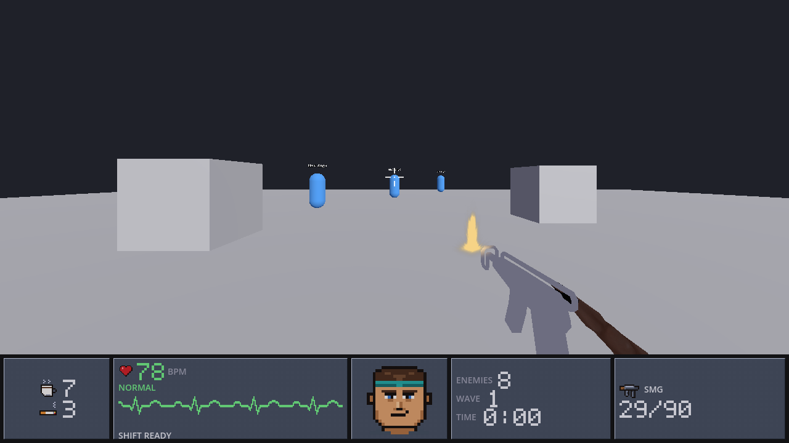
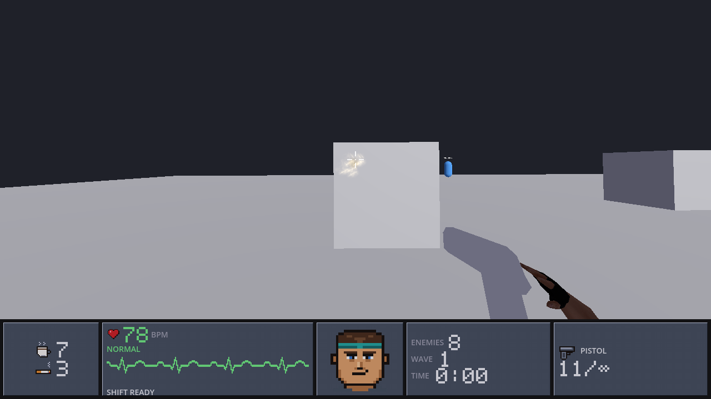
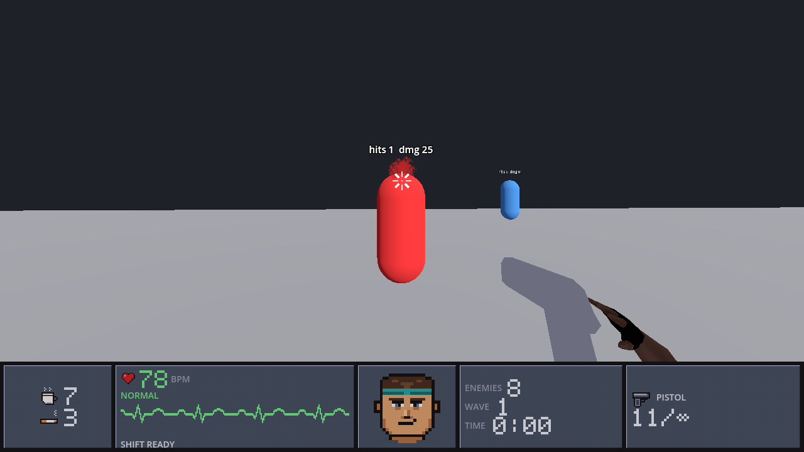
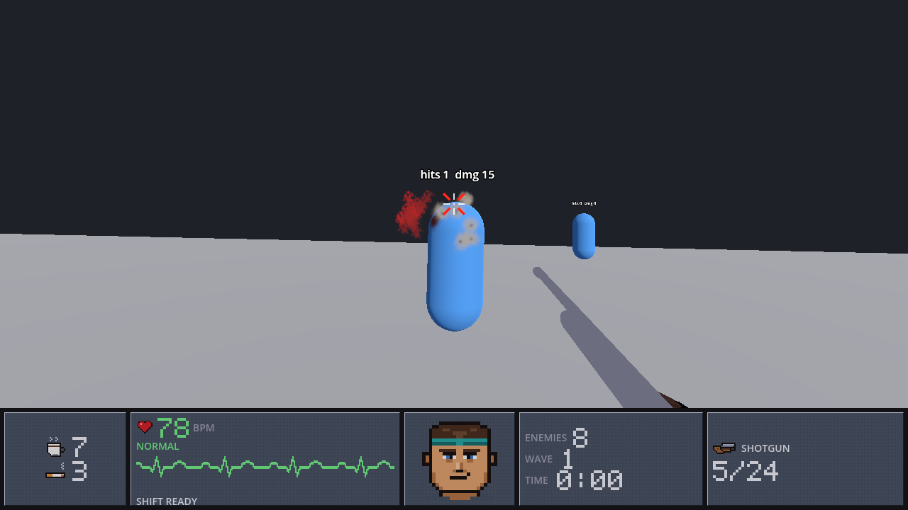
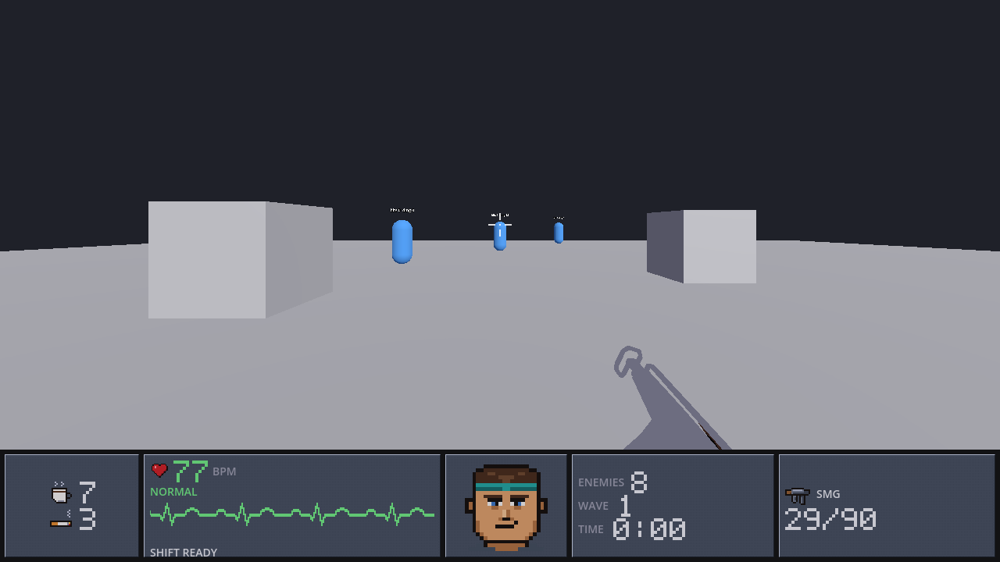

# Story 011 evidence: Shooting feel

Story: `production/epics/last-dose/story-011-shooting-feel.md` (Visual/Feel)
Captured: 2026-11-26, Godot 4.7.2, windowed 1280x720 Movie Maker capture (last frame kept).
Probe: `story-011-shooting-feel/probe.txt` (script copy `probe_script.gd.txt`).

## Screenshots

| # | What | Scene (frames) | File |
|---|---|---|---|
| 1 | Muzzle flash (SMG) | `src/player/test_range_feel_flash.tscn` (40) |  |
| 2 | Wall hit (pistol) | `src/player/test_range_feel_wall.tscn` (40) |  |
| 3 | Blood on a non-lethal hit | `src/player/test_range_feel_blood.tscn` (40) |  |
| 4 | Kill burst + kill marker (shotgun) | `src/player/test_range_feel_kill.tscn` (40) |  |
| 5 | Mid-reload (SMG) | `src/player/test_range_feel_reload.tscn` (52) |  |

## Review notes per criterion (self review, not a sign-off)

1. **Forgiving recoil, no drift**: probe, 30 SMG shots: peak kick 0.45 deg pitch; after recovery, kick (0,0), shake 0, player yaw/head pitch/camera rotation deltas all exactly 0.0. Feel of the kick/shake itself: needs playtest.
2. **Muzzle flash / dry click**: 01 shows a warm yellow flash at the SMG muzzle (held 8 frames by a debug export so the capture sees it). It sits slightly above/beside the barrel tip; muzzle offsets in `gun_feel.tres` are estimates. Dry click: a `dry_fired` / `dry_clicked` signal only (sound is story 012); not observed.
3. **Crosshair + hit/kill marker**: 03 shows the white hit X on a non-lethal hit; 04 shows the red kill X. Both seen.
4. **Wall impact + bullet hole, capped**: 02 shows sparks/dust at the impact on the box face. The bullet hole is not clearly distinguishable in the capture (it sits under the sparks). Probe: 120 holes emitted, max alive 40 = cap 40. Fade: not observed.
5. **Non-lethal hit: blood, flash, pushback**: 03 shows a dark red spray at the hit point and the dummy flashed red. Spray goes along the surface + outward normal (toward the shooter on a head-on hit), not strictly "along the shot" (data `spray_normal_blend` 0.8). Pushback: not visible in a still.
6. **Kill: bigger burst, floor splat, body pushed; splats fade, capped**: 04 shows a red burst, grey puffs and faint dark floor splats. Probe: 120 kills, max splats alive 48 = cap 48. Body push and fade: not observed in a still.
7. **Hitstop**: probe: one kill = 0.05 real s at time_scale 0.05, back to 1.0 after; 10 kills in a row: max pending 0.12 = cap 0.12, total 0.138 real s (frame granularity), back to 1.0. Input: a fire press during the freeze (windowed run, mouse captured) was kept and fired 1 shot after; buffer emptied. Only `ShiftAbility` writes `Engine.time_scale` in story code (pre-existing exception: `RunEndScreen.restart_run` sets 1.0 before reload, story 010).
8. **Arms hold each gun, follow recoil, reload timed**: 01/02/03 show a gloved right arm at the gun; on the pistol the hand reads as roughly on the grip, on the SMG the forearm runs under the gun, on the shotgun (04) the arm is barely in view. In 05 (mid-reload) the gun dips and tilts and the arm is out of view. Placement is approximate; needs an art pass.
9. **Cancelled reload blends; no near-plane clip**: not observed in a still (engine-check fix applied: reload motion tracks its gun and eases). Overlay camera near 0.01 on layer 20 (story 004).
10. **Feel values in data, pooled**: values in `assets/data/weapons/gun_feel.tres`, `impact_effects.tres`, `assets/data/viewmodel/viewmodel.tres`. Probe: effect pool 158 nodes before and after 240+ impacts; scene node count 315 -> 316 (one node, not per shot). Exceptions: `WeaponHolder.fire_buffer_seconds` (0.25, export default), `RealClock` 0.25 s cap and the 128 px generated alpha textures are in code.

Known weak spots for the reviewer: arm placement per gun, muzzle offset, bullet-hole readability, blood spray direction choice. The Kenney particle PNGs have no alpha (black squares cause); `ImpactEffects.make_alpha_texture()` builds alpha from brightness. Story 004's own particles remain disabled.

## Sign-off

- [ ] Approved — art/feel (name, date)
