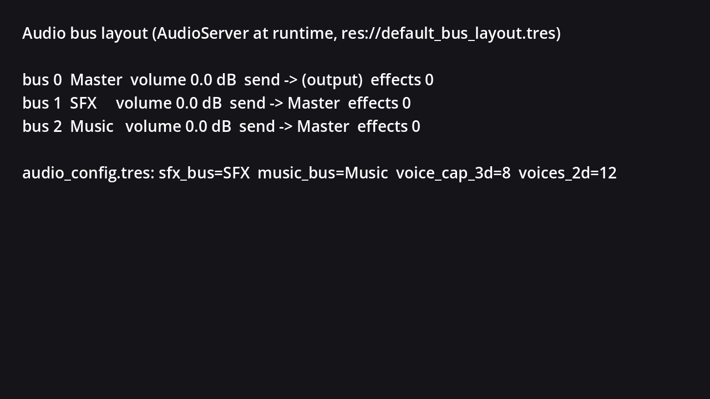
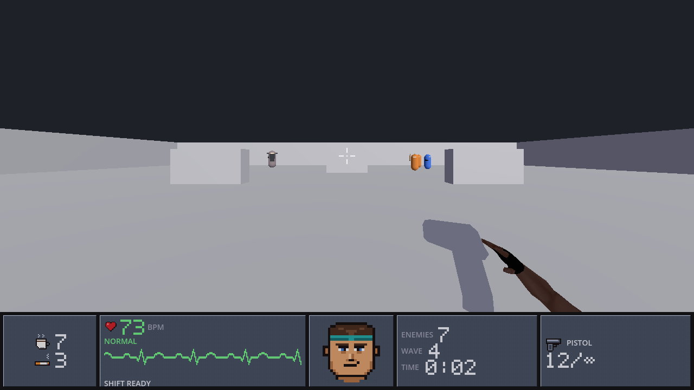

# Story 012 Evidence: Audio (guns, impacts, substances, heart rate, footsteps, music)

> **Story**: `production/epics/last-dose/story-012-audio.md`
> **Type**: Visual/Feel
> **Date**: 2026-11-26
> **Status**: waiting on sign-off. Nothing has been listened to yet; every check below is a probe log of which stream played, not a hearing test.

## Evidence files

- Probe log: [`story-012-audio/probe.txt`](story-012-audio/probe.txt), from three probes: `probe_range.gd.txt` (test_range: real guns, reloads, substances, heart rate), `probe_arena.gd.txt` (shotgun kill blast, dry click, test_arena_boss music/footsteps/landing/run end), and the programmer's direct-call probe `.scratch/probes/p012.gd`. The log also holds a listener check.
- Bus layout:  (runtime `AudioServer` read-out: Master, SFX -> Master, Music -> Master; no effects yet, story 013 adds the filters)
- Game running with the boss wave:  (`src/waves/test_arena_boss.tscn`, frame 150, HUD shows wave 4)
- File stamp: `story-012-audio/stamp.txt`

## Review notes per criterion (probe results)

| # | Criterion | What the probe showed | Left for listening |
|---|---|---|---|
| 1 | Gun shots, thump, dry click, reload parts | Pistol: `pistol.wav` plus tails `pistol_tail_01..04`, rotated with no back-to-back repeats. SMG: `smg.wav` plus tails `smg_tail_01..04`, rotated. Shotgun: `shotgun_close_01..04` and `shotgun_tail_01..04` rotated, plus `shotgun_thump_01` on every shot. Dry click (SMG empty, no spare): `dry_click_01` then `dry_click_02`. Reloads, as frame / progress: pistol mag_out 0.19, mag_in 0.38, rack 0.75; SMG mag_out 0.12, mag_in 0.47, rack 0.74; shotgun shell 0.16, pump 0.73. **Note:** pistol and SMG each have only ONE close-shot take (the in-house file), so the close layer repeats. Pitch and volume vary (about -1.3 to -2.9 dB) and the tail layer rotates. | Does SMG auto fire sound repetitive? |
| 2 | Flesh at the hit point (3D), heavier kill, at most one each per blast | Pistol hit: `flesh_hit_0x` at (0, 1.6, -17.65), the dummy. One 8-pellet shotgun blast that killed the dummy played exactly 1 `kill_burst_03` and 0 flesh/surface sounds. A blast with 1 dummy hit and 7 floor hits played 1 flesh and 2 surface sounds. The direct-call probe gave 3 blasts -> hit 3, kill 3, surface 6. The listener check found the root viewport is the only 3D listener (player camera), and both SubViewports are off. | Panning and distance |
| 3 | Surface impact, 3D, variants, capped per shot | `bfh1_hit_05/08/09/11`, `bfh1_rock_hit_01` and `bfh1_rock_breaking_03` played at floor hit points. Never more than 2 per shot. | Variety |
| 4 | Consume loop while held, fade on release, used-up sound | Coffee held: `ngopi.wav` playing. After release it stops with a fade (0.25 s). Cigarette: `ngudud.wav` starts and stops the same way. A used-up coffee unit played `substance_taken.wav`. | Fade smoothness |
| 5 | Heart loops: silent at 60–100, full at 10 and 190, smooth, fade on run end | Real HeartRate driven to: 80 -> low 0 / high 0, both stopped; 30 -> low 0.48 lin (-6.4 dB); 10 -> low 0.80 (-1.9 dB = configured max); 150 -> high 0.444 (-7.0 dB); 190 -> high 0.80 (-1.9 dB). After `run_ended` at 120 bpm the high loop fades out and stops, and `has_ended` is true. "Full volume" is the data max of 0.8 linear (`heart_low/high_max_volume`). | Is 0.8 loud enough? |
| 6 | Footsteps loop above a speed threshold, fade stop; landing once per dive or long fall | Real `move_forward` input in the arena: walking at 5.0 m/s, `footstep_for_walking.wav` playing at level 1.0. On release it stops. One real dive gave landing_count 1. A 4 m drop raised it to 2. A 0.3 m drop left it at 2. | Step loop rhythm vs walk speed |
| 7 | Combat loop; boss crossfade in while a boss lives, back after the last boss dies | `test_arena_boss`: `bgm_combat.wav` starts. When the boss spawns, `crossfade_to_boss` runs (boss 1.0, combat 0.0). After the boss is killed, `crossfade_to_combat` runs (combat 1.0, boss 0.0, boss player stopped). Fades run on real time (RealClock). | Crossfade length, pops |
| 8 | Buses (SFX, Music); 3D pool with capped voices | Every player node's AudioStreamPlayer uses the SFX bus; music uses the Music bus. The 3D pool has 8 voices (`voice_cap_3d`) and the 2D pool has 12. See screenshot 02. | — |
| 9 | All clip lists, volumes, pitch ranges, distances in data | `assets/data/audio/audio_config.tres` holds every clip list, volume, variation, distance, cap, fade and threshold. The code has only normalisation constants (-80 dB silence, epsilon). | — |
| 10 | Files brought over with source and licence | Every clip comes from `assets/audio/{music,sfx,sfx/synth}` or the `assets/third_party` packs. Each of these folders has a row in `assets/credits.md`. | — |

Known minor issues from the engine check, left as they are:
- When all voices are busy, the voice that gets cut is picked round-robin, not the oldest.
- A reload that is cancelled and restarted within one frame does not replay its sounds.
- `default_bus_layout.tres` has no explicit `bus/0` block. Godot creates Master anyway.

## Listening checklist (the person's)

- [ ] Pistol, SMG and shotgun shots each distinct; SMG auto fire not obviously repetitive
- [ ] Shotgun low thump audible
- [ ] Dry click on an empty gun with no spare ammo
- [ ] Reload: magazine out, magazine in, rack land on the motion
- [ ] Flesh hit comes from the enemy's position; kill is heavier; one blast = one flesh/kill
- [ ] Surface impacts on walls and floor, with variety
- [ ] Coffee and cigarette loops while held, short fade on release, used-up blip
- [ ] Heart loops: silent at a normal rate, growing toward 10 and 190, fade at run end
- [ ] Footsteps while walking, stop cleanly; one landing thud after a dive or a long fall
- [ ] Combat music; boss music crossfades in and back out after the boss dies; no pops

## Sign-off

- [ ] Approved — art/feel (name, date)
