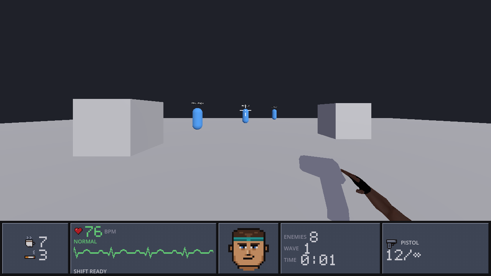
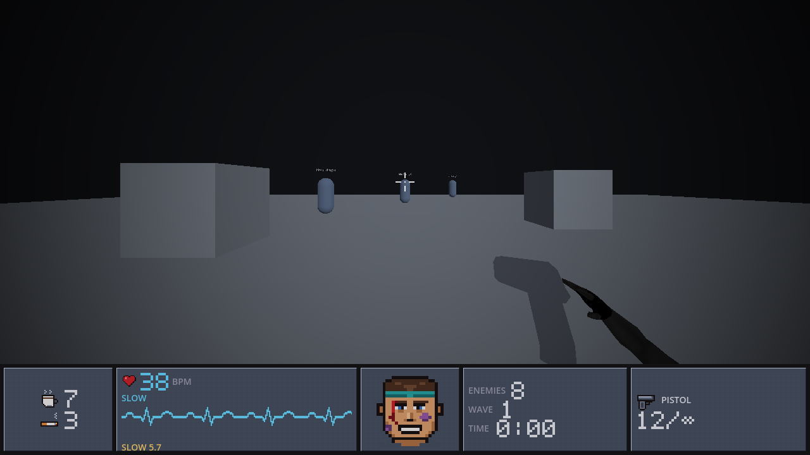
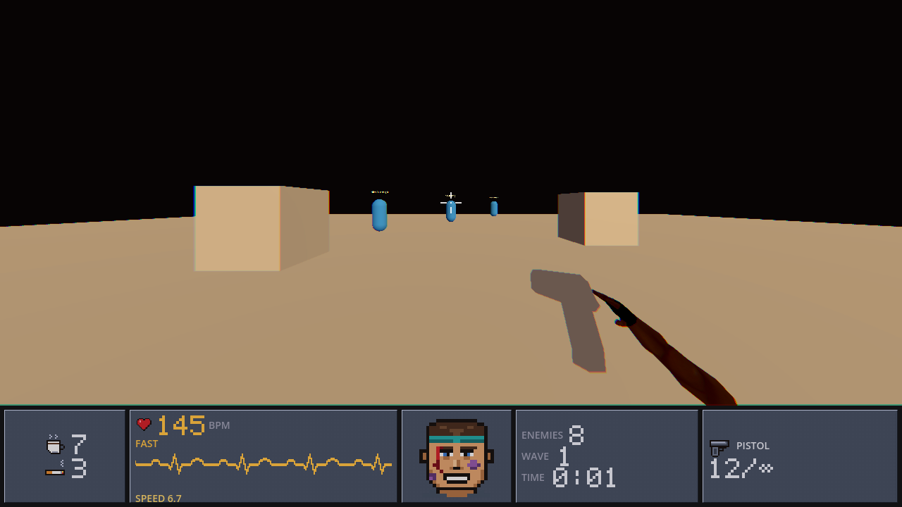

# Story 013 evidence: Ability screen feel (slow-motion and superspeed look)

Story: `production/epics/last-dose/story-013-ability-screen-feel.md` (Visual/Feel)
Captured: 2026-11-26, Godot 4.7.2, windowed 1280x720 Movie Maker capture (last frame kept), 90 frames each, Shift pressed at physics frame 10 (look at full weight by about frame 50).
Probe: `story-013-ability-screen-feel/probe.txt` (script copy `probe_script.gd.txt`; drives `AbilityLook.tick()` in 1/60 s steps with the node's own processing off).

## Screenshots (same spot, same view)

| # | What | Scene | File |
|---|---|---|---|
| 1 | Normal (rate 76, no ability) | `src/player/test_range_look_normal.tscn` |  |
| 2 | Slow motion (rate 38) | `src/player/test_range_look_slow.tscn` |  |
| 3 | Superspeed (rate 145) | `src/player/test_range_look_speed.tscn` |  |

## Review notes per criterion (self review, not a sign-off)

1. **Slow motion: desaturated, cool, vignette.** 02: colours drained (blue dummies go grey-blue), image darker (exposure 0.8), dark vignette visible in the upper corners. The cool cast is faint because saturation 0.25 removes most of the blue tint; vignette raised 0.3 -> 0.45 over Unity. Whether it reads "strong GTA-style" needs a person's eye.
2. **Superspeed: warm, high contrast, wider FOV, chromatic aberration.** 03: strong warm/amber grade, harder contrast, objects smaller and further apart (FOV +12 — probe `camfov_delta=12.00`), RGB fringes on the box and gun edges (CA 0.3). Contrast raised 1.12 -> 1.25 over Unity. Side effect for the reviewer: the dark sky is crushed to pure black by the contrast pivot (0.5). The viewmodel camera copies the FOV, so the gun also widens.
3. **Ease in/out, no snap on ability end / early end / run end.** Probe: weights follow smoothstep over 0.5/0.7 s (slow) and 0.25/0.5 s (speed); the largest change of the blend per 1/60 s frame is 0.05 (slow) and 0.10 (speed, 0.25 s ease-in). Run end mid-superspeed eases out from the current values to exactly neutral in 0.5 s (FOV 12 -> 6 -> 0); slow motion ended early at 0.2 s eases back to neutral. AbilityLook is PROCESS_MODE_ALWAYS, so the grade keeps easing while the run-end screen pauses the tree; known gap: the world/viewmodel mirror cameras are pausable, so the FOV ease-out is not visible behind the paused run-end screen (it is reset on restart). Feel of the timing: needs playtest.
4. **Audio muffled + lower pitch in slow motion; brighter/higher in superspeed; eased; back to normal.** Probe reads the SFX and Music bus effects directly: slow full = low-pass 900 Hz on, pitch 0.85 on; superspeed full = high-pass 250 Hz on, pitch 1.06 on; mid-ease values in between (cutoff blended in log space); at neutral every effect is back to 22000 / 10 / 1.00 and disabled. Freeing the scene removes the effects (0); re-adding the scene twice keeps 3 per bus (no duplicates on reload). Master bus untouched. Not heard: whether it sounds right needs playtest (pitch values are own choices; `Engine.time_scale` does not slow audio by itself).
5. **Own layer, stacks with story 014, order written.** Order is in the story's Implementation Notes: world -1, viewmodel 0, ability look 1, story 014 vignette 2 (reserved), HUD 3, run-end 30. Screens show the HUD ungraded and the grade covering world + viewmodel. FOV is an additive offset (GunFeel 50, AbilityLook 55). Stability with story 014 switched on cannot be checked until 014 exists — deferred.
6. **Every value in data.** `assets/data/player/ability_look.tres`: saturation, contrast, exposure, tint, vignette (+ smoothness, colour), CA, FOV delta, low/high-pass cutoffs, pitch (+ FFT size), ease in/out per ability, layers, buses, neutral cutoffs. Exception: the CA maximum UV offset (0.012) is the shader uniform default, not in the .tres.

Known weak spots for the reviewer: cool tint weak under heavy desaturation; superspeed sky crushed to black; gun widens with the FOV; pitch 0.85 / 1.06 are guesses; FOV ease-out hidden behind the paused run-end screen.

## Sign-off

- [ ] Approved — art/feel (name, date)
