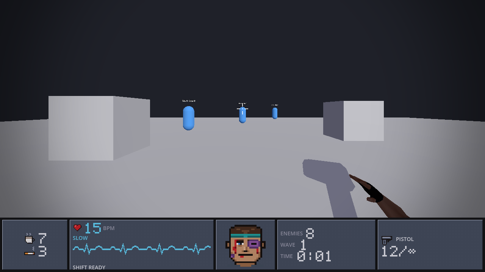
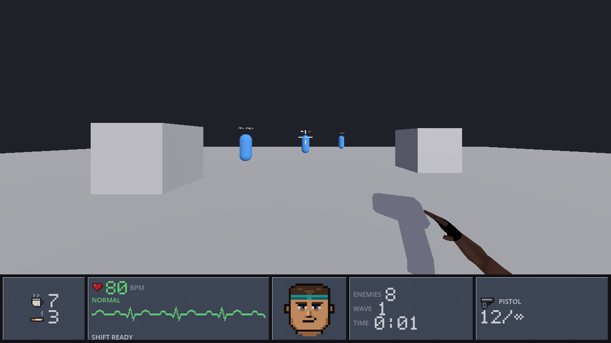
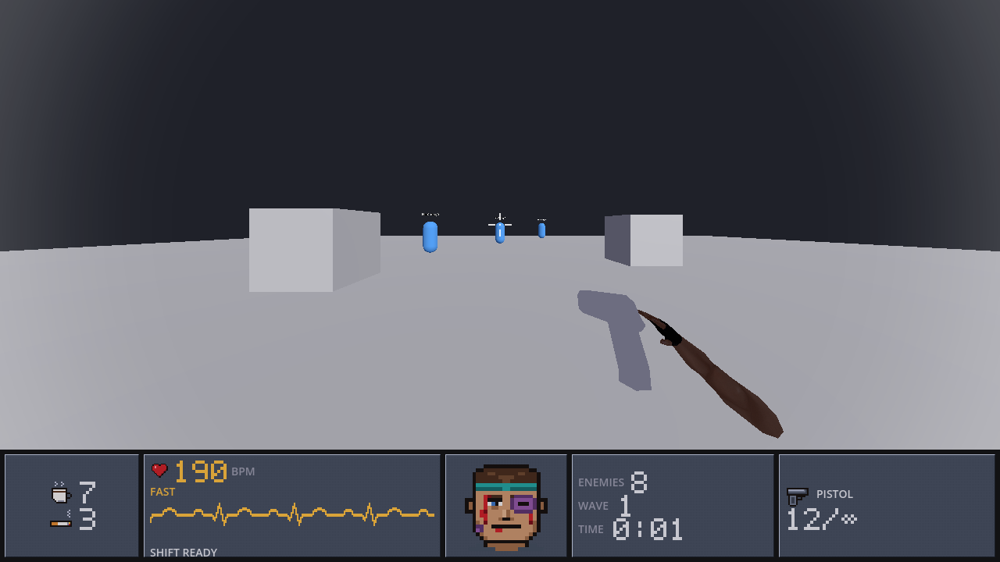
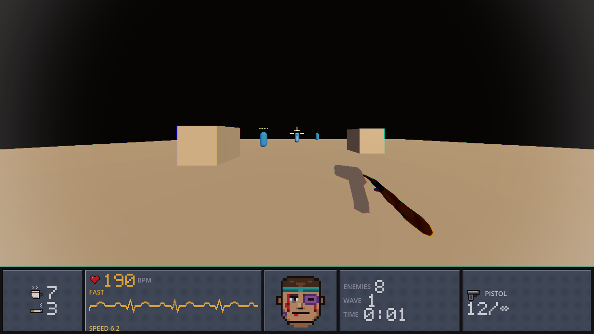

# Story 014 evidence: Heart-rate vignette and field of view

Story: `production/epics/last-dose/story-014-heart-rate-vignette-fov.md` (Visual/Feel)
Captured: 2026-11-26, Godot 4.7.2, windowed 1280x720 Movie Maker capture (last frame kept), 120 frames each, rate held each physics frame (`debug_hold_heart_rate`; the screen reads about 0.05 bpm below the held value because the heart's own drop runs after the hold).
Probes: `story-014-heart-rate-screen/probe.txt` (scripts `probe_script_b.gd.txt`: drives `HeartRateScreen.tick()` in 1/60 s steps with the node's own processing off; `probe_script_c.gd.txt`: the live superspeed scene, run end while paused, slow motion timing).

## Screenshots (same spot, same view: test_range spawn)

| # | What | Scene | File |
|---|---|---|---|
| 1 | Low (15 bpm) | `src/player/test_range_hr_screen_low.tscn` |  |
| 2 | Normal (80 bpm) | `src/player/test_range_hr_screen_normal.tscn` |  |
| 3 | High (190 bpm) | `src/player/test_range_hr_screen_high.tscn` |  |
| 4 | High (190) + superspeed (Shift at frame 10) | `src/player/test_range_hr_screen_high_speed.tscn` |  |

Corner pixels (top-left / bottom-left of the world view; centre floor 162,162,169 in all): normal 31,33,41 / 163,163,170 (no vignette); low 18,19,24 / 95,95,99 (black vignette); high 70,71,78 / 179,179,184 (white vignette); high+superspeed 50,47,47 / 188,165,136 (white over the sepia ability grade, sky crushed to 7,4,4 in the centre).

## Review notes per criterion (self review, not a sign-off)

1. **White above, black below, none in 60-100; from data.** Screens 1-3 and the pixel samples above. Probe `target` lines: 0 at 60, 80, 100; black 0.012 at 59 rising to 0.6 at 10 and below; white 0.0028 at 101 rising to 0.25 at 190 and above. Curve (rest band, limits, exponent), colours, intensities and radii are in `assets/data/heart/heart_rate_screen.tres` (Unity heart_rate_screen.json values; low radii 0.4/1.0 are our own). The low vignette is subtle against the dark sky; it shows mostly on the floor corners. Readability needs a person's eye.
2. **FOV +20 at 190, -8 at 10, continuous.** Probe: +20.000 at 190, -8.000 at 10, linear between (e.g. +10 at 145, -4 at 35); a 0.5 bpm sweep from 0 to 220 never steps more than 0.111 deg or 0.006 intensity. Screens: low is visibly narrower (boxes larger), high wider.
3. **Smooth follow, no pop.** Exponential ease, `response_seconds` 0.6 (data). Jump 80->150: FOV offset 0.30, 0.60, 0.89 ... per frame, largest frame step 0.30 deg; 63% after 0.6 s as expected. Jump 150->30 (crossing sides): white fades to 0 before black grows, largest frame step 0.0097 intensity, no colour snap at a visible strength. Feel: needs playtest with real coffee/cigarette/hits.
4. **Pulse near the limits, harder in the countdown, max 3/s validated on load.** Probe: no pulse at 120/160/40 (depth 0); 175 -> depth 0.25, 185 -> 0.42, 190 -> 0.50 (drawn 0.125..0.25); 25 -> 0.25, 15 -> 0.42, 10 -> 0.50 (0.30..0.60); during the countdown (rate 193.5, 4.5 s left) depth 0.70 at 2/s (4 troughs in 2 s, drawn 0.075..0.25). Validation: 3.0 passes; 3.01, 3.5, -1, NaN, INF fail; a screen given countdown rate 4.0 logs the error at `_ready` (when the screen loads the data) and stays fully neutral (`is_data_valid=false`). Note: "fails when the data loads" is implemented as the screen refusing the data on load, not as a resource-level load failure. Whether 1/s and 2/s at those depths are comfortable needs a person.
5. **Stacks with gun punch, dive offsets and ability look.** FOV is an additive offset (remove-and-re-add) at process priority 56, after GunFeel 50 and AbilityLook 55, before the Hud mirrors 100. Live superspeed probe: look +12, heart +19.35, main camera 106.35 = world mirror = viewmodel camera. Own CanvasLayer 2 (above the ability look at 1, below the HUD at 3). `stack_mode` in data: BLEND (default, both shown, screen 4) or LARGER (heart vignette drawn only by the amount it exceeds the ability vignette). Dive camera offsets touch position/rotation only, not FOV: not exercised together in a capture. LARGER mode not captured.
6. **Camera-motion scale.** Probe: scale 0 at 190 -> FOV offset 0.0000 and camera FOV stays 75.000 (vignette still 0.25); 0.5 -> +10; 1 -> +20. The scale applies to this story's FOV change only (GunFeel punch and superspeed FOV are not scaled).
7. **Stops at run end, unscaled time.** Probe: after `on_run_ended` the drawn intensity, FOV offset and pulse are 0 and stay 0; with the tree paused (as the run-end screen does) the world mirror and viewmodel cameras also drop back (106.35 -> 87.0 = 75 + superspeed 12, which AbilityLook eases out itself). Slow motion 0.3: after 0.600 s wall time the ease reached 0.623 (unscaled expectation 0.632; if game time it would be 0.259).
8. **No near-plane clipping at the widest FOV.** Widest combined FOV = 75 + 20 + 12 = 107 deg (gun punches are negative). Viewmodel camera near 0.01 m, gun/hand pivots at least 0.2 m in front. Screen 4 (106.35 deg) shows the pistol and arm whole, no cut edge. Shotgun/SMG at the widest FOV not captured.

Known weak spots for the reviewer: the low (black) vignette is faint against the dark test-range sky; the vignette pulse cannot be judged from stills; at superspeed the sepia grade plus white corners looks hazy rather than bright.

## Sign-off

- [ ] Approved — art/feel (name, date)
