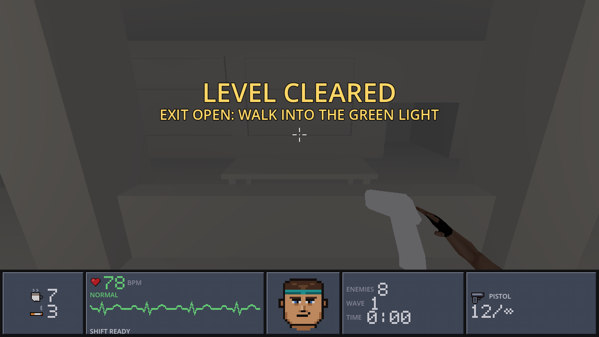
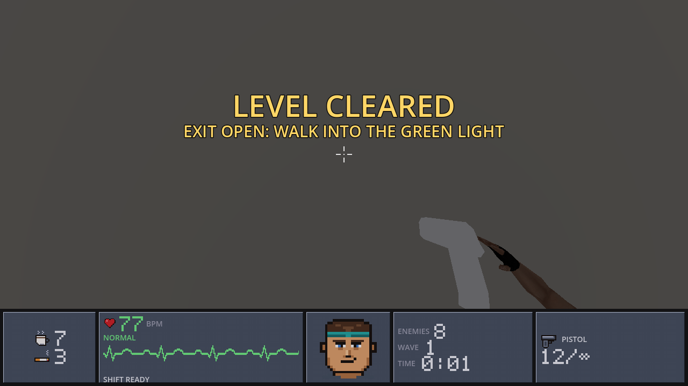
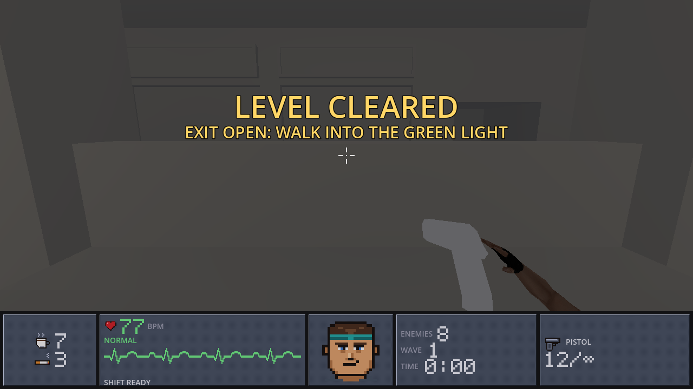
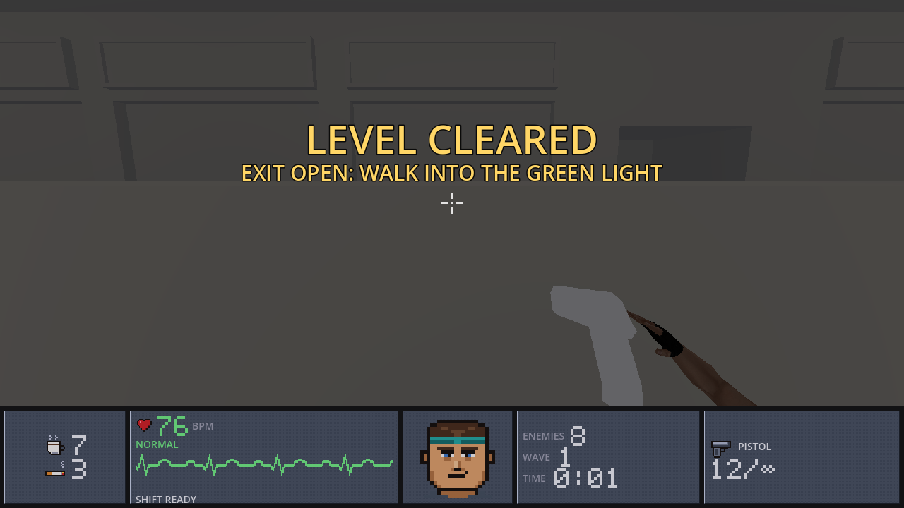

# Story 017 evidence: the dive clears obstacles (Visual/Feel)

Story: `production/epics/last-dose/story-017-dive-clears-obstacles.md`. Final code: edge-lift (`air_step_height` 0.8) capped at start floor + `air_step_max_reach` 1.3.
Probe output: `story-017-dive-clears-obstacles/probe.txt` (sweeps, run-up trials, hang). Stamp: `story-017-dive-clears-obstacles/stamp.txt`.

## Screenshots (first-person, real canteen; scenes `src/levels/test_canteen_dive_*.tscn`, dive at physics frame 30)
Positions come from the DIVE lines in each capture's `.log`. The first-person frames are hard to read on their own.
- : frame 43, start x -0.725 facing -x. The player is rising over the table at x -1.71 (AIRBORNE at frame 45, y 1.08). The table and the bench behind it are visible below the crosshair.
- : frame 70, the same dive.
  - Lands on the table top at x -1.85 (SLIDE, frame 47).
  - Runs off the far edge (AIRBORNE, frame 60).
  - Lands on the bench seat at x -2.94, y 0.46 (SLIDE, frame 66).
  - The frame shows the bench divider close up.
- : frame 55, start x 0.075. SLIDE on the table top at y 0.96 (frame 47).
- : frame 77.
  - AIRBORNE after running off the table edge (frame 74).
  - Then SLIDE on the bench (frame 80), then GET_UP.

## Review notes per criterion
- **AC1, table:** DEFERRED (feel).
  - A 0.4–2.2 m run-up carries the player onto or over the table.
  - Every canteen table has a fixed bench 0.5 m behind it, so the dive ends on the bench seat (or the divider top at 0.8–1.1 m), never on open floor.
- **AC2, bench:** DEFERRED (feel).
  - A 0.4–1.5 m run-up (and 1.8 m) clears the bench, including its 1.28 m divider, to open floor.
  - 1.6–1.7 m and 1.9–2.2 m stop on the seat.
- **AC3, landing on a table top:** COVERED.
  - Lands, slides, runs off, falls and lands again.
  - `badgetup=false` in every run-up trial, so the player never gets up in mid-air.
  - PNGs 03 and 04.
- **AC4, edge-lift and tall obstacles:** partly COVERED.
  - The lift was used in 76 of 372 canteen sweep dives.
  - Walls taller than the step were never climbed. Tall contacts climbed: 2 of 108, the same spots as with the lift off.
  - The canteen has no counter, so walls were the only too-tall case.
- **AC5, no passing through, no out-of-reach spots:** canteen COVERED, plaza OPEN (needs a designer's judgement).
  - Canteen:
    - No through-geometry hits.
    - The one head/ceiling hit also happens with the lift off.
    - The highest end point is 1.37 m both with and without the lift.
  - Plaza:
    - No added head/ceiling hits (4 with the lift, 4 without).
    - The heuristic through-geometry check hit 9 times with the lift and 11 without.
    - 7 dives end 0.3 m or more higher than without the lift: on surfaces at y 1.18–2.43, five of them from ground level.
    - Example trace, start (-13.31, 0, 18.55): the lift raises the player from 0.43 to 1.23, inside the cap. The slide then climbs a walkable slope to y 2.3.
    - Whether those plaza spots are meant to be out of reach is for the designer to judge in play. Flagged spots are in `probe.txt`.
- **AC6, the rest of the dive unchanged:** COVERED for the slow-motion hang.
  - Hang factor 2.0 is latched; launch plus airborne goes from 23 to 47 ticks.
  - Note: in slow motion the same dive ended on the table top (x -1.70), not the bench (x -2.94).
  - Phases, firing through the dive and cooldown were not changed in code. They were not re-tested in play.
- **AC7, numbers in data:** COVERED. `air_step_margin`, `air_step_probe_distance`, `air_step_search_steps` and `air_step_max_reach` are in `assets/data/player/dive.tres`.

## Sign-off
- [ ] Approved — art/feel (name, date)
