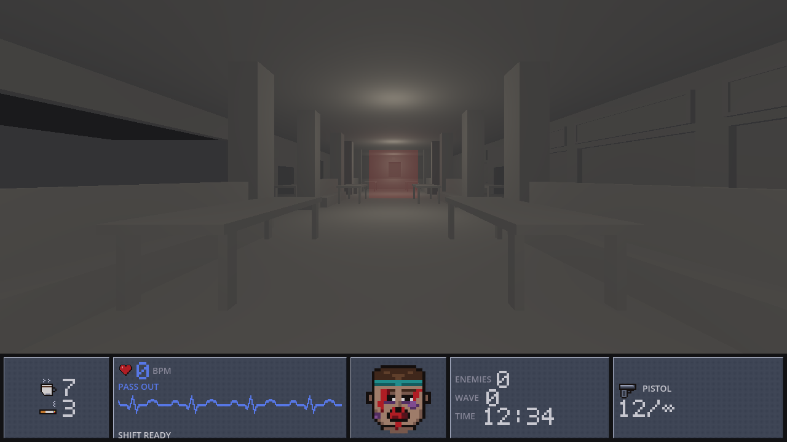
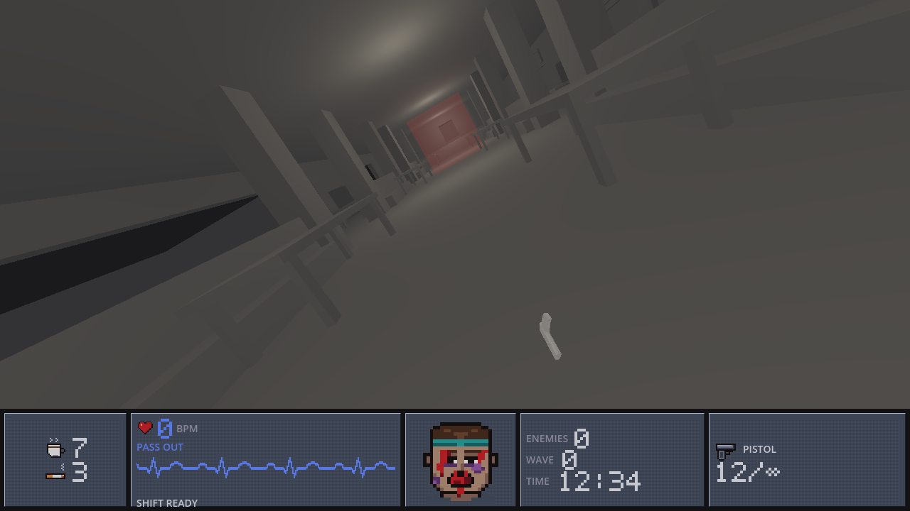
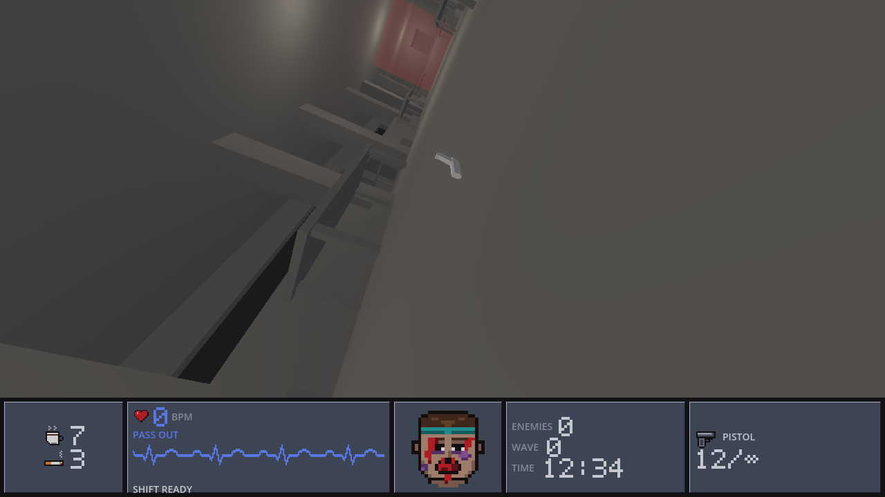
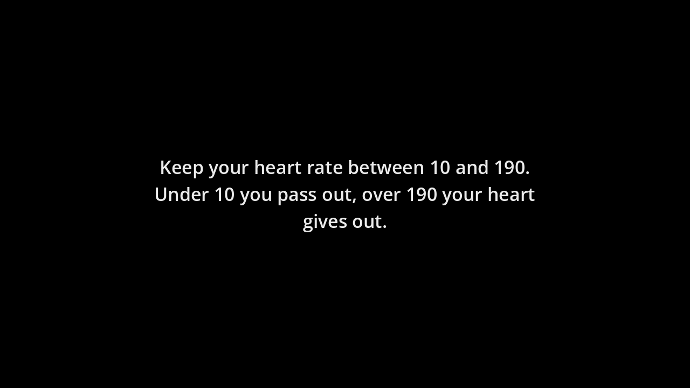

# Story 018 evidence: death and loading flow (collapse, fades, tip)

Story: `production/epics/last-dose/story-018-death-and-loading-flow.md` (Visual/Feel)
Captured: 2026-11-26, Godot 4.7.2, 1280x720 windowed captures (`bash .scratch/capture.sh`), canteen, pass-out death.
Probe: `story-018-death-and-loading-flow/probe.txt` (script copy `probe_script.gd.txt`), 15 modes, headless at 60 fps.
Stamp: `story-018-death-and-loading-flow/stamp.txt`.

## Screenshots

| # | Moment | File | Scene / frame |
|---|---|---|---|
| 1 | Mid-buckle |  | `src/run/game_death_buckle.tscn`, frame 110 (collapse frozen at 0.14 s) |
| 2 | Mid-fall |  | `src/run/game_death_fall.tscn`, frame 130 (frozen at 0.55 s) |
| 3 | At rest, gun on the floor |  | `src/run/game_death_rest.tscn`, frame 200 |
| 4 | Tip on black |  | `src/run/game_death_tip.tscn`, frame 300 |
| 5 | Black screen during a load |  | `src/run/game_loading_black.tscn`, frame 30 |

## Review notes per criterion (reviewer: pipeline self-review, no independent review)

1. **Buckle, then tip over, fall, roll, settle.** In capture 1 the view is still level, slightly lowered, and the arms and gun are already gone. In capture 2 the view is rolled hard and the gun is in mid-air. In capture 3 the view lies on its side near the floor. Probe `flow`: buckle 0 ms, fall 251 ms, settle 900 ms, rest 1101 ms. That matches the data: buckle 0.25 s, collapse 0.9 s, bounce 0.2 s. Max roll was 65 and max pitch 30. **Whether it feels right needs your judgement.**
2. **No clipping; falls away from a wall or a hit; deterministic.**
   - The probe checked the camera at every collapse frame with a 0.1 m sphere. It found no overlap in any mode (0/67 frames), including a wall at the side and a wall in front.
   - Wall 1.14 m on the right: the view fell left (−1), and the rest camera moved 0.5 m away from the wall.
   - Using `compute_fall_side`:
     - a recent hit on the right gives left; a recent hit on the left gives right;
     - a hit older than 2 s, or one straight ahead, gives the data side (right);
     - a wall to the right gives left.
   - All three repeats were identical. The rest camera transform was identical across the `flow`, `slowmo`, `notip` and `tip0` runs.
   - **Not viewed in a capture against a wall.**
3. **Arms drop, gun falls and stays, crosshair hides, status bar frozen.**
   - Captures 1–3: the arms and the substance are gone from the first frames. The pistol is a physics body visible mid-air in capture 2 and lying on the floor in capture 3.
   - Probe: the gun is released at 85 ms. Its velocity is 0 by 1.4 s, then it sleeps at the same position until the results (about 1.07 m from the player). Facing a wall, it lands 0.72 m away on the room side.
   - The crosshair is hidden on the frame after run end (`crosshair_visible_after_end=false`).
   - The status bar shows 0 BPM / PASS OUT / 12:34 throughout (captures 1–3).
4. **Unscaled time; comfort 0.**
   - Probe `slowmo` held Engine.time_scale at 0.1 from run end. The collapse, hold, fade and tip took the same real times as at 1.0 (rest 1101 ms, results 7967 ms).
   - Probe `comfort0`: max roll 0, max pitch 0, no frame where the camera rose (so no bounce), 0 m sideways movement, and only the drop to rest height 0.3.
   - **Hitstop was not probed separately.** It writes the same time scale.
5. **Hold, fade, tip, results; skip; empty list or time 0.**
   - Probe timings (ms after run end):
     - rest at 1101;
     - fade starts at 2317 (hold 1.2 s);
     - tip at 2834 (fade 0.5 s);
     - results at 7983 (tip 0.6 + 4.0 + 0.5 s).
   - Capture 4 shows the tip centred on black with the HUD covered.
   - Enter or a left click during the tip brought the results within 16 ms. It did not restart: 2 s later the same scene was still loaded and `_restarting` was false.
   - With an empty list, and with `tip_hold_seconds` 0, the results come straight after the fade (same ms) and no tip is shown.
   - "Never the same tip twice in a row" is not observable with the single tip in data. It is implemented as a static last-tip memory.
6. **Single fade layer.** The probe read the layers: fade 20, tip 25, results 30, HUD 3. Capture 4 shows the fade covering the game view and the HUD. RunFlow, LevelRotation and RunEndScreen all use the one `ScreenFade` (`fade_to_black` / `fade_clear` and the `fade_finished` signal).
7. **Level starts black and fades in only when ready; a load failure still fades in.**
   - The first frame is at alpha 1. The screen is clear at frame 20, with 0 frames where alpha < 1 before the level was ready. Capture 5 is solid black with the fade held.
   - In the `loadfail` mode every level scene was replaced by a non-level. It logged `LEVEL scene 0 is not a LevelBase` and `LEVEL not ready ... fading in anyway`, and alpha reached 0 by frame 20.
8. **Restart and level change.**
   - Mid-run `restart_run()`: the screen reached alpha 0.992 on the last sampled frame and reloaded at 283 ms (fade 0.2 s). The new scene started covered (0.80 at the probe's first frame, already fading) and cleared after the level was ready.
   - From the results screen the fade is already black, so the reload is immediate.
   - Travel to plaza: the fade went to 1.0, the level loaded at alpha 1, and the screen cleared after it was ready, through the same fade.
9. **Unscaled fades; everything in data.**
   - All durations, layers, colours, the tip and its timing, the fall rules and the gun physics are `@export` fields on `DeathFlowData` / `TipListData`.
   - `assets/data/run/death_flow.tres` stores no overrides, so the Unity values live as the class defaults.
   - The level fades use `LevelRotationData` (travel 0.6/0.5) and `DeathFlowData` (`level_fade_in_seconds` 0.4, `restart_fade_out_seconds` 0.2).

## Not covered / for the playtest
- How the collapse feels: pacing, roll amount, the bounce.
- A collapse against a wall, seen on screen (probe only).
- A real enemy hit just before death (probe used `record_hit` / `compute_fall_side`).
- Hitstop during the collapse.
- Several tips rotating without a repeat.

## Sign-off
- [ ] Approved — art/feel (name, date)
