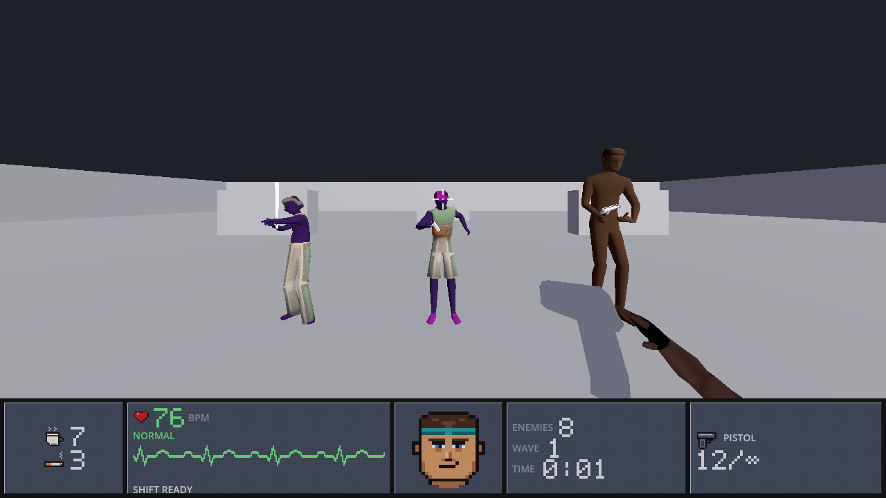
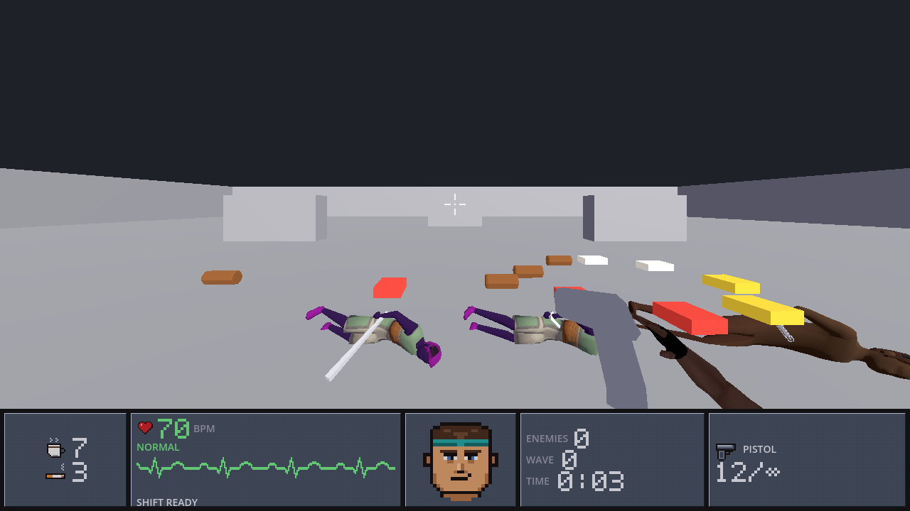

# Story 020 — Human enemy models and animations: evidence

Story: `production/epics/last-dose/story-020-enemy-models-and-animations.md` (Visual/Feel)
Captured: 2026-11-26, Godot 4.7.2, windowed Movie Maker, 1280x720. Probe lines: `story-020-enemy-models-and-animations/probe.txt`.

## Screenshots (left to right in each: melee, ranged pistol, boss)

| State | Image | Scene / frame |
|---|---|---|
| Idle |  | `src/waves/test_arena_enemy_models_idle.tscn`, frame 120 |
| Mid-attack |  | `src/waves/test_arena_enemy_models_attack.tscn`, frame 72 |
| Dead |  | `src/waves/test_arena_enemy_models_dead.tscn`, frame 240 |

## Review notes per criterion

1. **One model + texture**: all three use the enemy_base rig with `rs_textures_bot.png`; melee/ranged wear a random enemy_a/b/c skin, boss enemy_base. Texture visible in 01-idle (clothing detail, no grey/untextured surfaces). COVERED (image + probe).
2. **Height 1.8 m, boss 1.3x and darker**: probe heights 1.8 / 1.8 / 2.34; boss visibly taller and darker brown in 01-idle. COVERED.
3. **Idle / run / weak walk, loops**: probe: loop flags idle/walk/run = 1, attack clips = 0; live run shows `enemy_run` while chasing (3.5-3.8 m/s), `enemy_idle_breathing` when stopped; walk_weak selected for 0.15-1.9 m/s (direct call). Feet matching ground speed: DEFERRED (needs eyes in play).
4. **Melee club + hit on the swing**: club on palm_R visible (01, 02); probe: player hit lands 0.45 s after the swing clip starts (clip hit time 0.425 s, 1 physics frame granularity). Whether that frame is where the club visibly connects: DEFERRED (Unity's 0.425 s is itself "to confirm by stepping the clip").
5. **Ranged prop, muzzle, attack clip per shot, reload**: prop on palm_R with a `*_tip` muzzle for pistol/shotgun/smg (probe muzzle-to-palm 0.13 / 0.62 / 0.20 m); shooting state plays `enemy_attack_pistol_001`; reload state shows a lean + tilt. The pistol reads very small in the images; prop orientation in the hand and the reload look: DEFERRED.
6. **Boss SMG**: one SMG prop, muzzle at its tip (0.27 m from palm), `enemy_attack_smg` on the upper body (filter from spine_b). Small in 02-attack. Partly covered; look DEFERRED.
7. **Hit stagger / upper-body jolt / knockback**: implemented (pose modifier, 0.3 s); not captured. DEFERRED.
8. **Death**: code-driven fall along the shot (NOT a ragdoll, NOT a death clip; pose frozen) — 03-dead shows three bodies lying. Probe: corpses leave `enemies`, layer 4 / mask 1 (player mask 1, enemies mask 3: no block/push), re-hit gives no second death and pushes 0.14 m, cap 6 after 11 kills, all freed by kill + 7 s (linger 4 + fade 1.5). Fade look and blood on corpse: DEFERRED.
9. **Source and licence**: `assets/credits.md` already credits `art/enemies/`, `art/weapons/`, `art/textures/` to gankdroid; inventory rows in `docs/port/unity-asset-inventory.md`. COVERED (file check).

## Things the reviewer should look at
- Pistol and boss SMG props look tiny / hard to see; hand offsets are all zero (props attached at identity, mount scale 1/100).
- Death is a stiff tip-over, not a ragdoll; decide whether that is acceptable.
- Boss armour plates were dropped when the model is used (tint only).
- In 03-dead the boss falls toward the camera and its body overlaps the player view at close range.

## Sign-off
- [ ] Approved — art/feel (name, date)
